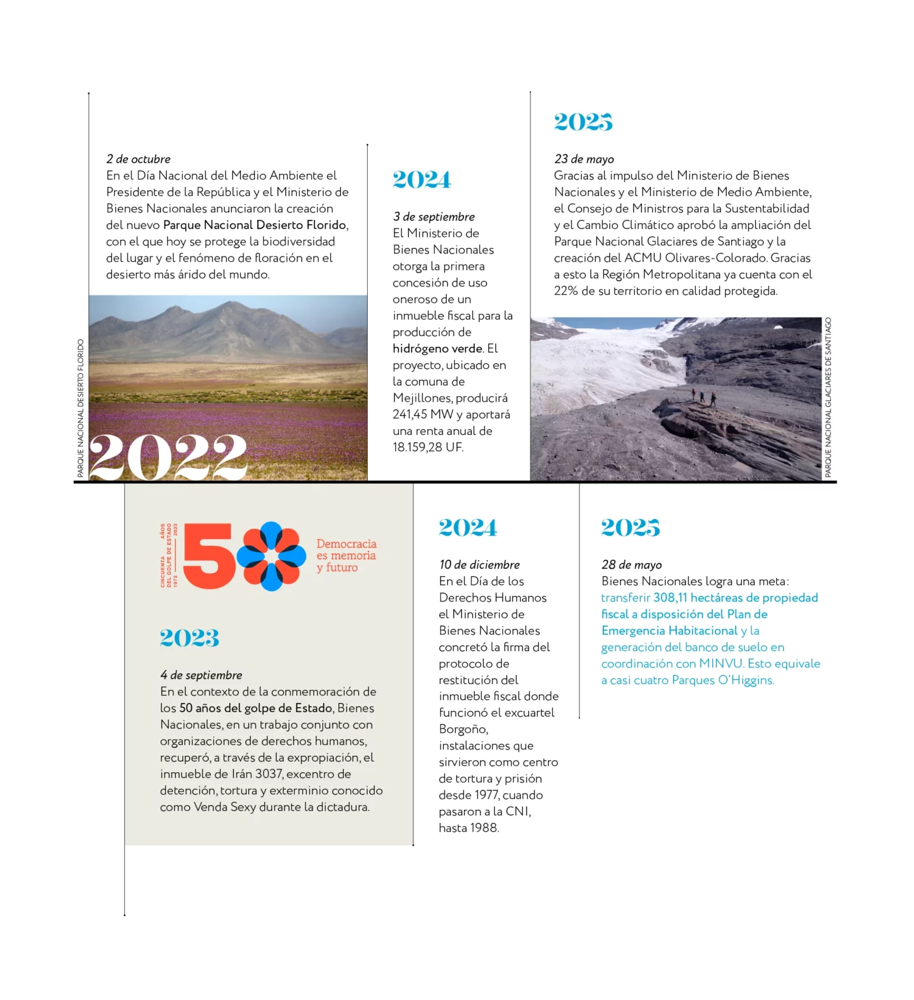
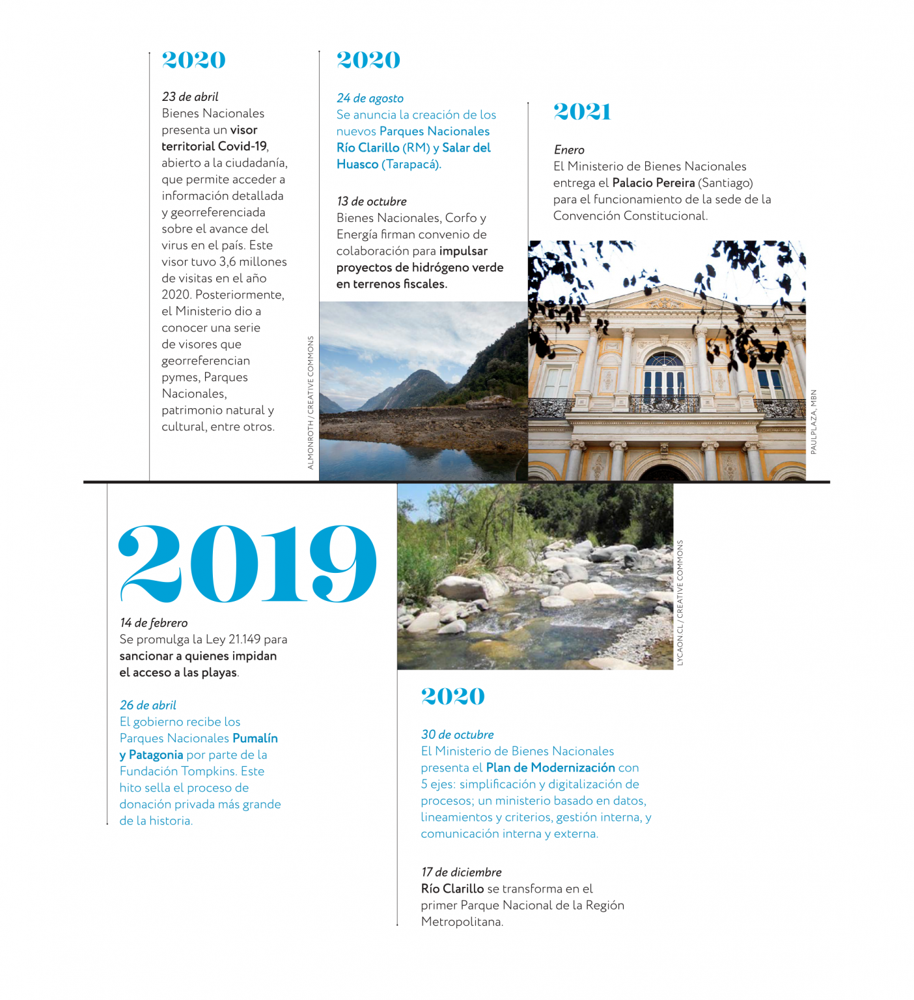
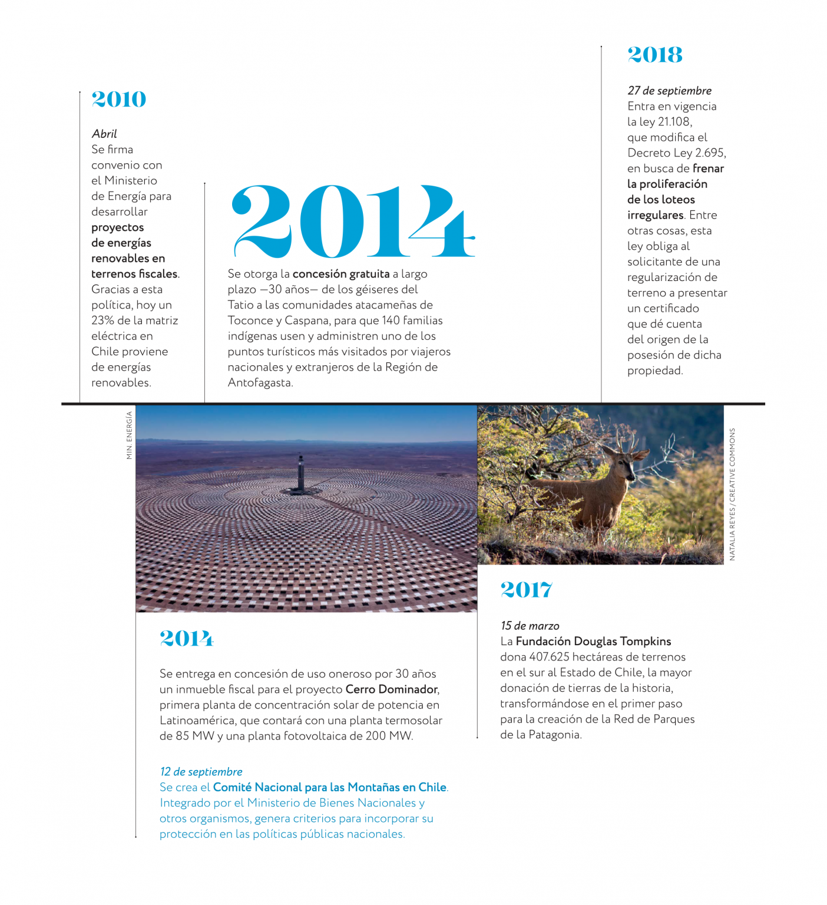
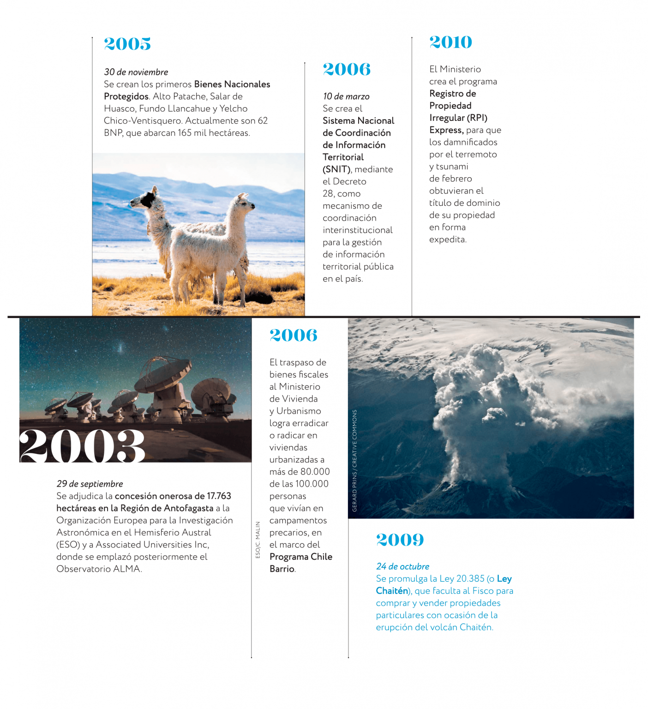
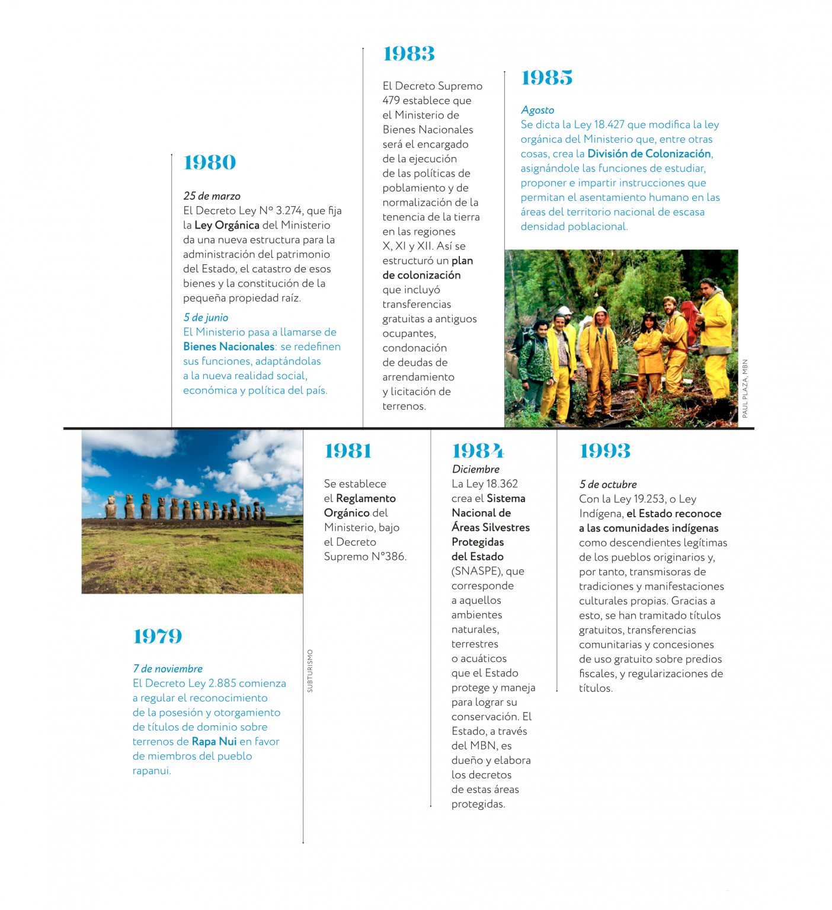
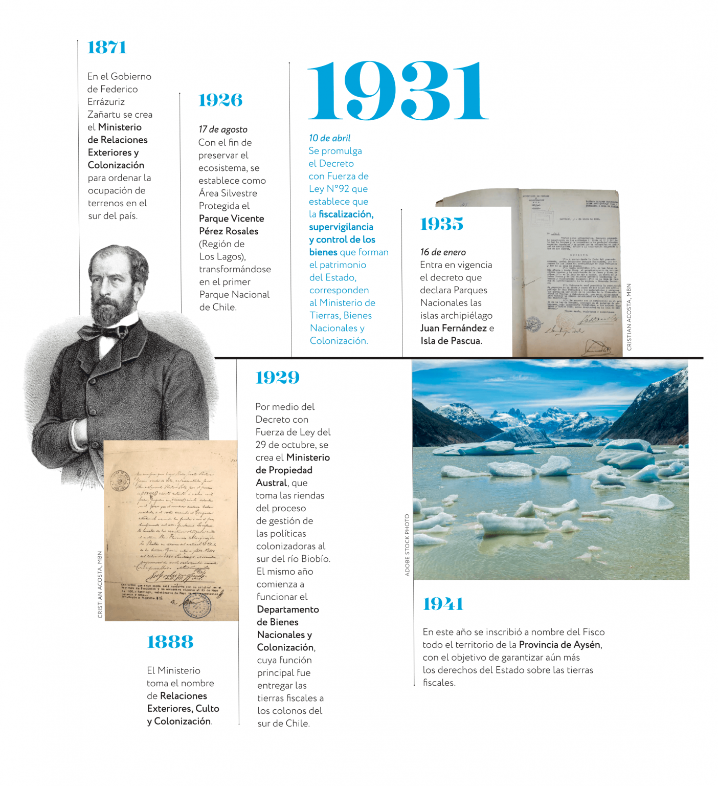

Nuestra misión es administrar y resguardar el patrimonio fiscal, colocándolo al servicio de las necesidades sociales, ambientales, culturales y económicas del país en beneficio de todas y todos sus habitantes.

A través de una gestión articulada y descentralizada del territorio, actualmente trabajamos por reducir el déficit de suelo para viviendas dignas, la restitución de tierras a pueblos originarios, el fortalecimiento de espacios de memoria y derechos humanos, la protección y el acceso al patrimonio natural y el impulso de las energías renovables no convencionales, entre otros desafíos.

## Conoce la historia del Ministerio año a año

### 2022 – 2025

### 2019 – 2021

### 2010 – 2018

### 2005 – 2010

### 1994 – 2004

### 1979 – 1993

### 1942 – 1979

### 1871 – 1941

